# Incident Tracker REST API (Gin + PostgreSQL + GORM + JWT + Swagger)

[](https://go.dev/)
[](https://gin-gonic.com/)
[](https://gorm.io/)
[](https://www.postgresql.org/)
[](http://localhost:8080/swagger/index.html)

Практична робота №5 з дисципліни **«Розробка застосувань клієнт-серверної архітектури»**  
**Тема:** Розробка REST-сервісу на базі фреймворку Gin та СУБД PostgreSQL  
**Студент:** Шевченко І.І., група КНз-31  
**Викладач:** Верещагін Олександр Олександрович  
**Навчальний заклад:** Природничо-гуманітарний фаховий коледж ДВНЗ «Ужгородський національний університет»  

---

## 📌 Опис проєкту

**Incident Tracker API** — це високопродуктивний бекенд-сервіс обліку та управління технічними інцидентами й аваріями на підприємстві. Сервіс спроєктовано за клієнт-серверною REST-архітектурою з підтримкою трьох рівнів складності (Базовий, Ключовий, Просунутий).

### 🚀 Реалізований функціонал:
* **Рівень 1 (Базовий):** 
  - Ініціалізація високопродуктивного HTTP-двигуна Gin із використанням пулу пам'яті `gin.Context`;
  - Пул з'єднань із базою даних PostgreSQL через GORM та автоматична міграція схем (`AutoMigrate`);
  - Декларативна валідація DTO за допомогою тегів `binding` (`required`, `min`, `max`, `oneof`);
  - Створення інцидентів (`POST /api/v1/incidents`) та публічний перегляд списку (`GET /api/v1/incidents`).
* **Рівень 2 (Ключовий):** 
  - Повний CRUD життєвий цикл: отримання за ID (`GET /api/v1/incidents/:id`), часткове оновлення статусу (`PATCH /api/v1/incidents/:id/status`), видалення (`DELETE /api/v1/incidents/:id`);
  - Модель користувача з унікальним індексом email та прихованим хешем пароля (`json:"-"`);
  - Безпечне криптографічне хешування паролів за допомогою алгоритму `bcrypt` (`bcrypt.DefaultCost`);
  - Випуск підписаних безсесійних JWT-токенів (`golang-jwt/jwt/v5`, алгоритм `HS256`, строк дії 24 години).
* **Рівень 3 (Просунутий):**
  - Кастомний захисний `AuthMiddleware`, що перехоплює заголовок `Authorization: Bearer <token>`, валідує цифровий підпис та блокує несанкціоновані запити статусом `401 Unauthorized`;
  - Автоматичне витягування та прокидання `userID` у контекст `gin.Context` із прив'язкою інциденту до автора;
  - Повноцінна інтерактивна документація **Swagger UI (OpenAPI)** за адресою `http://localhost:8080/swagger/index.html` з підтримкою тестування та кнопкою авторизації `Authorize`.

---

## 🗂 Структура проєкту

```
T5-REST/
├── cmd/
│   └── api/
│       └── main.go           # Точка входу: ініціалізація БД, Swagger та маршрутизатора Gin
├── config/
│   └── database.go       # Підключення до PostgreSQL через GORM та авто-міграція
├── models/
│   ├── incident.go       # GORM-модель Incident та DTO (CreateIncidentDTO, UpdateStatusDTO)
│   └── user.go           # GORM-модель User та DTO (RegisterDTO, LoginDTO, AuthResponseDTO)
├── middleware/
│   └── auth.go           # Кастомний JWT AuthMiddleware для захисту приватних ендпоінтів
├── handlers/
│   ├── auth.go           # Обробники реєстрації та входу інженерів
│   └── incident.go       # CRUD-обробники керування інцидентами
├── utils/
│   └── jwt.go            # Утиліти генерації та верифікації JWT-токенів (HS256)
├── docs/                 # Згенеровані утилітою swag файли OpenAPI (docs.go, swagger.json, yaml)
├── screenshots/          # Знімки роботи сервісу та тестування
├── capture_screenshots.js # Автоматизований сценарій інтеграційного тестування
├── .gitignore
├── go.mod
├── go.sum
└── README.md
```

---

## 🛠 Технологічний стек

* **Мова програмування:** Go (Golang) 1.23+
* **HTTP Вебфреймворк:** [Gin Web Framework](https://github.com/gin-gonic/gin)
* **ORM:** [GORM](https://gorm.io/) з драйвером `gorm.io/driver/postgres`
* **СУБД:** PostgreSQL 16
* **Автентифікація:** [golang-jwt/jwt/v5](https://github.com/golang-jwt/jwt) (HS256)
* **Хешування:** [golang.org/x/crypto/bcrypt](https://pkg.go.dev/golang.org/x/crypto/bcrypt)
* **Валідація:** [go-playground/validator/v10](https://github.com/go-playground/validator)
* **Документація:** [swaggo/swag](https://github.com/swaggo/swag) та [swaggo/gin-swagger](https://github.com/swaggo/gin-swagger)

---

## ⚙️ Інструкція із запуску

### 1. Передумови
Переконайтеся, що на машині встановлено Go 1.22+ та працює сервер PostgreSQL на порту `5432`.

### 2. Клонування репозиторію
```bash
git clone https://github.com/Zelon4ik/T5-REST.git
cd T5-REST
```

### 3. Налаштування бази даних
Створіть базу даних `incident_tracker`:
```sql
CREATE DATABASE incident_tracker;
```

За потреби налаштуйте змінні середовища (за замовчуванням використовуються `localhost:5432`, користувач `postgres`, пароль `postgres`):
```bash
export DB_HOST=localhost
export DB_PORT=5432
export DB_USER=postgres
export DB_PASSWORD=postgres
export DB_NAME=incident_tracker
export JWT_SECRET=super-secret-incident-tracker-key-2026
export PORT=8080
```

### 4. Генерація документації Swagger (за потреби оновлення)
```bash
swag init -g cmd/api/main.go
```

### 5. Запуск сервера
```bash
go run cmd/api/main.go
```

Сервер запуститься за адресою: **`http://localhost:8080`**  
Документація Swagger UI буде доступна за адресою: **`http://localhost:8080/swagger/index.html`**

---

## 📡 Специфікація API ендпоінтів

| Метод | Маршрут | Опис | Доступ |
|---|---|---|---|
| `GET` | `/ping` | Перевірка працездатності (Health Check) | Публічний |
| `GET` | `/swagger/*any` | Інтерактивна документація Swagger UI | Публічний |
| `POST` | `/api/v1/auth/register` | Реєстрація нового облікового запису інженера | Публічний |
| `POST` | `/api/v1/auth/login` | Автентифікація користувача та отримання JWT токена | Публічний |
| `GET` | `/api/v1/incidents` | Отримання переліку всіх інцидентів | Публічний |
| `POST` | `/api/v1/incidents` | Реєстрація нового інциденту (прив'язка до `user_id`) | **Захищений (Bearer JWT)** |
| `GET` | `/api/v1/incidents/:id` | Отримання деталей інциденту за первинним ключем | **Захищений (Bearer JWT)** |
| `PATCH` | `/api/v1/incidents/:id/status` | Оновлення статусу інциденту (`open`, `in_progress`, `resolved`, `closed`) | **Захищений (Bearer JWT)** |
| `DELETE` | `/api/v1/incidents/:id` | Видалення інциденту за ID | **Захищений (Bearer JWT)** |

---

## 📸 Результати тестування та скріншоти роботи

### 1. Інтерактивна документація Swagger UI
Повний опис структури API, схем моделей та можливість тестування через кнопку **Authorize**:
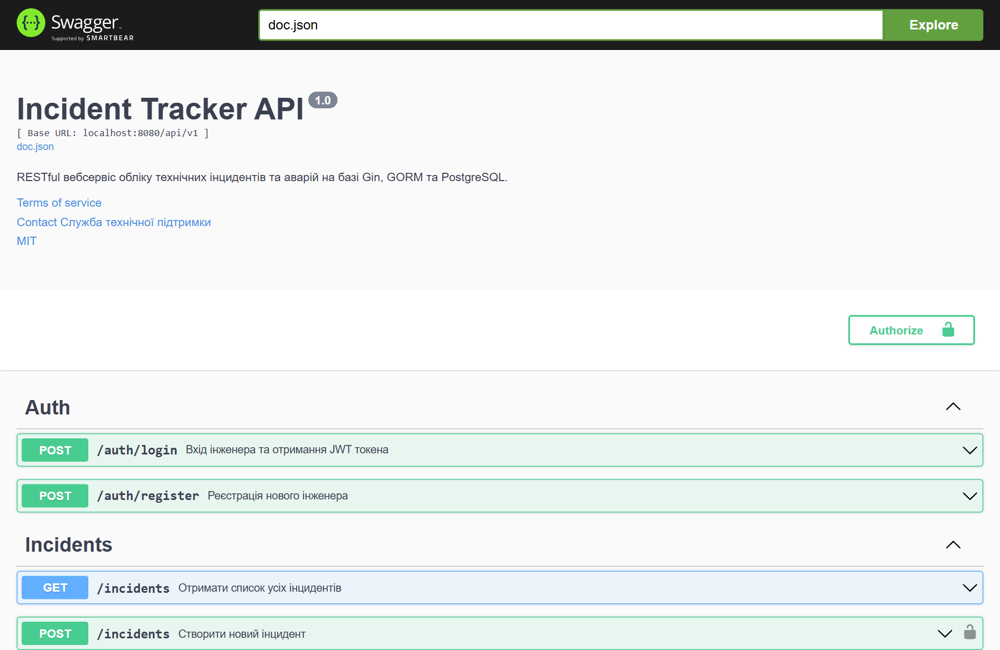

### 2. Реєстрація інженера (POST /api/v1/auth/register)
Успішна реєстрація зі статусом `201 Created`. Пароль збережено у формі стійкого bcrypt-хешу:
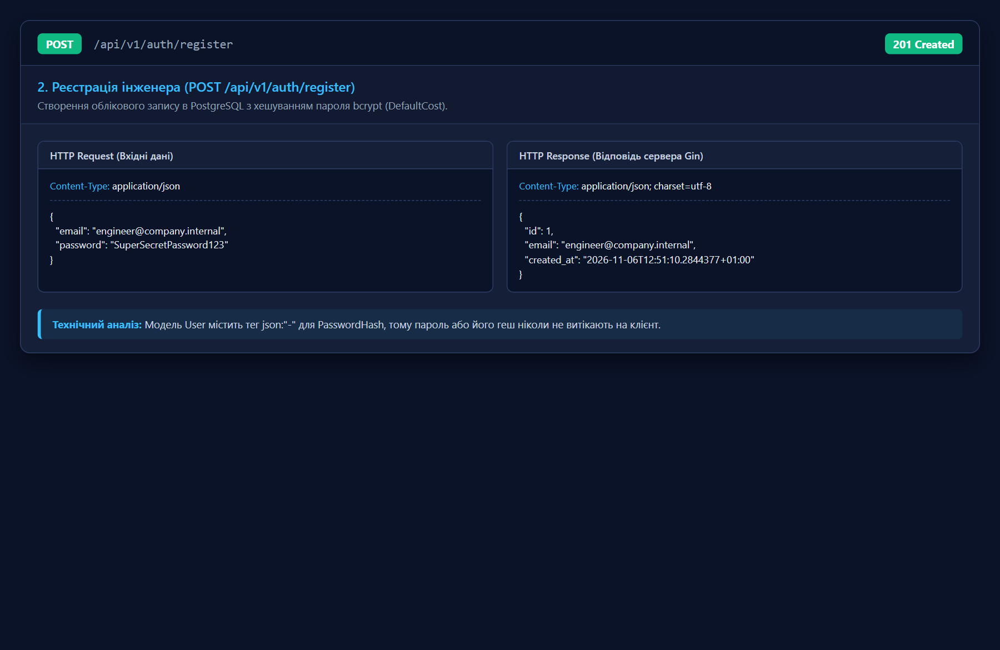

### 3. Автентифікація та видача JWT (POST /api/v1/auth/login)
Успішний вхід інженера та генерація підписаного JWT токена:
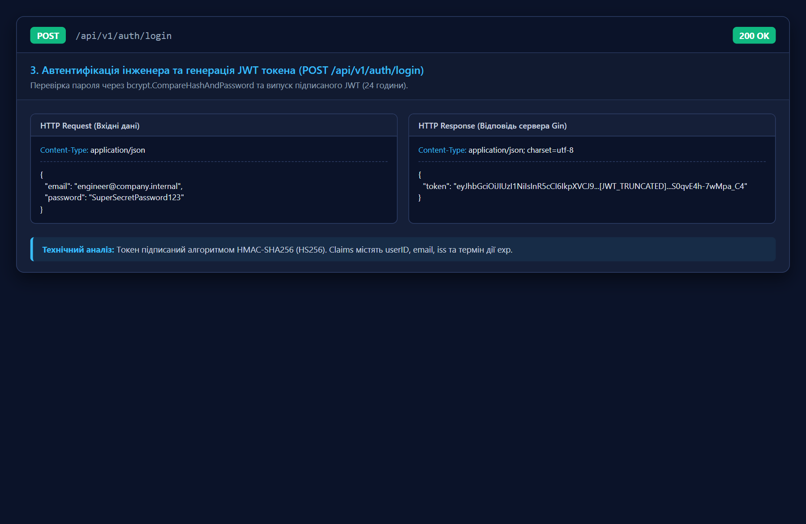

### 4. Декларативна валідація вхідних DTO (400 Bad Request)
Сервер автоматично відхиляє інцидент із невалідним пріоритетом `urgent` та коротким заголовком:
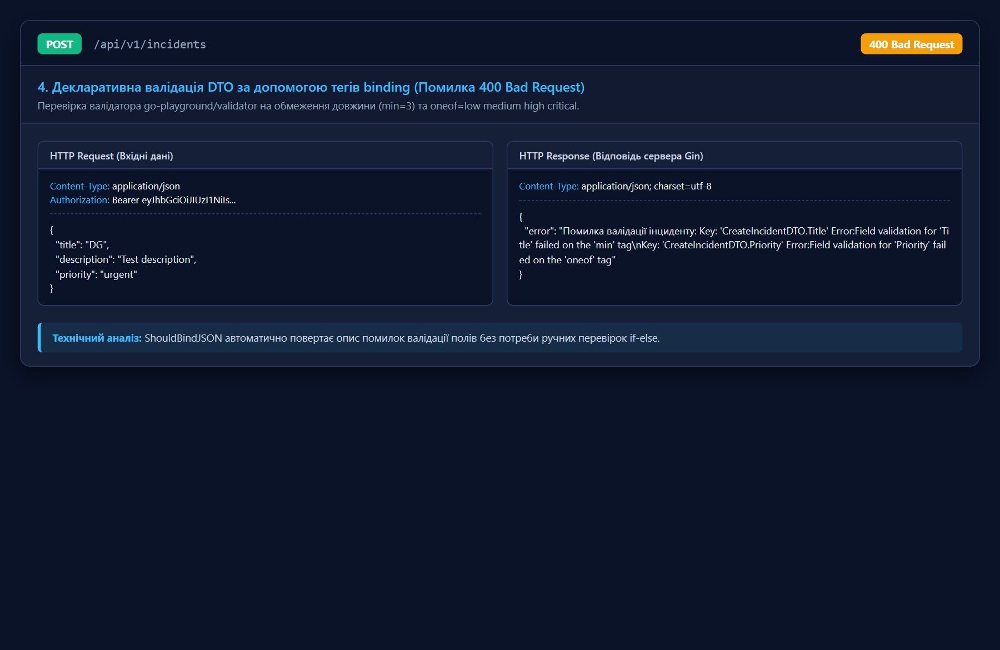

### 5. Успішне створення інциденту (POST /api/v1/incidents)
Створення інциденту з валідним токеном. Поле `user_id` встановлено автоматично з контексту:
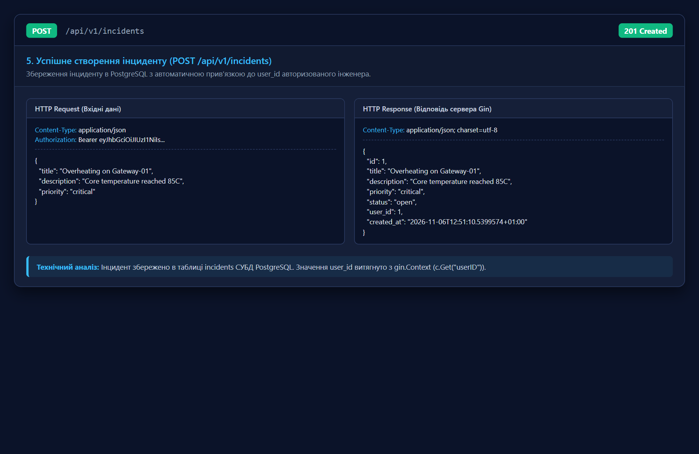

### 6. Перегляд каталогу інцидентів (GET /api/v1/incidents)
Публічний ендпоінт вичитування записів із PostgreSQL:
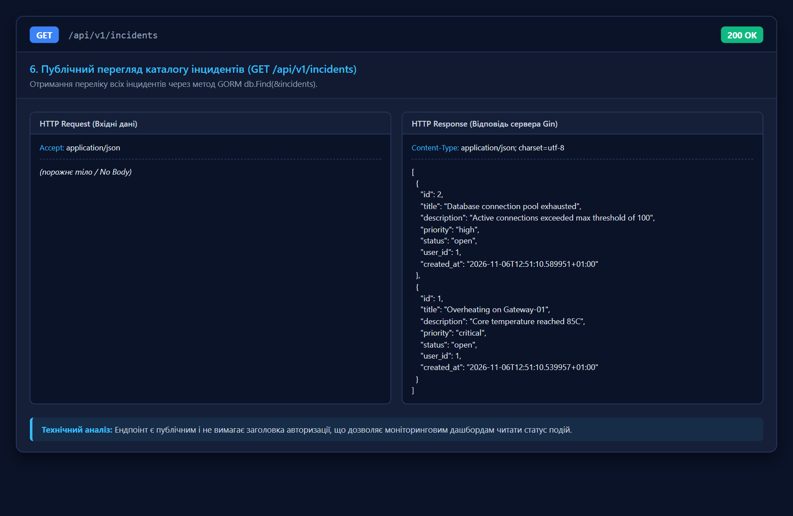

### 7. Отримання інциденту за ID (GET /api/v1/incidents/:id)
Пошук за параметром шляху зі статусом `200 OK`:
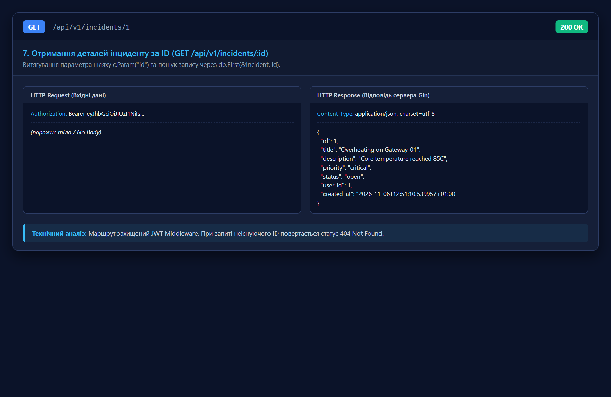

### 8. Оновлення статусу інциденту (PATCH /api/v1/incidents/:id/status)
Зміна статусу на `in_progress`:
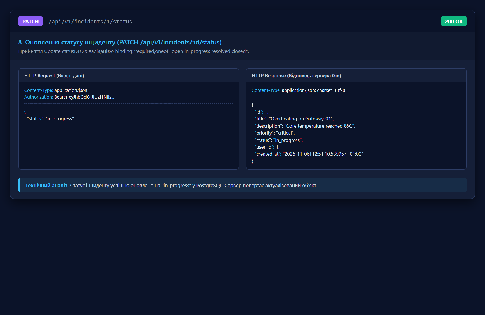

### 9. Захист приватних маршрутів (401 Unauthorized)
Спроба видалення запису без токена негайно переривається мідлваром:
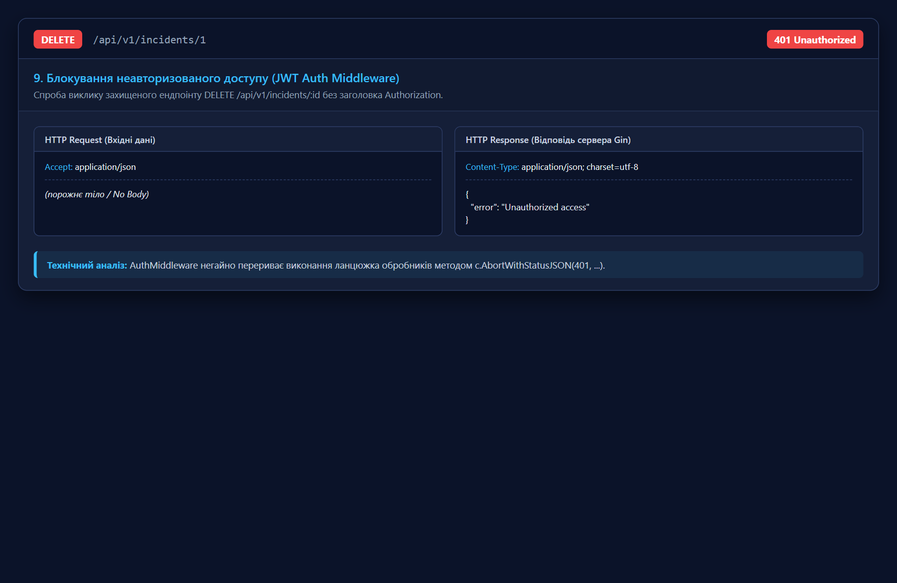

### 10. Видалення інциденту за ID (DELETE /api/v1/incidents/:id)
Успішне видалення з поверненням статусу `204 No Content`:
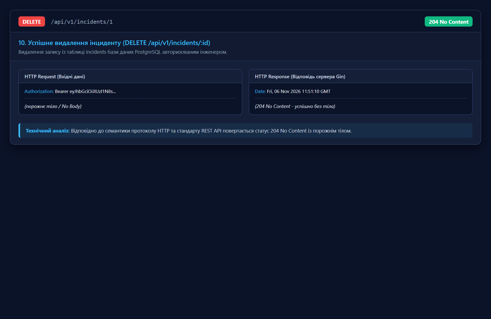

### 11. Консоль запуску та маршрутизації
Демонстрація старту Gin-двигуна, з'єднання з PostgreSQL та авто-міграції:
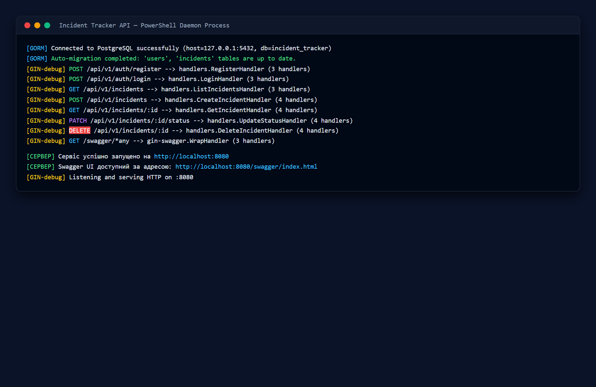
